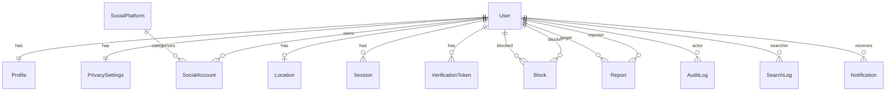

# Database ERD (PostgreSQL + PostGIS, PK = UUID)

## Tabel inti

**User**: id, email (unik, lower), emailVerifiedAt, passwordHash (argon2id), username (unik) + normalizedUsername (unik), status (ACTIVE|SUSPENDED|PENDING_DELETION), deletedAt, createdAt, updatedAt.

**Profile**: id, userId (unik), displayName, bio, avatarUrl, createdAt, updatedAt.

**SocialPlatform**: id, key (instagram, x, tiktok, …), name, urlTemplate, isActive. Seed data.

**SocialAccount**: id, userId, platformId, username, normalizedUsername, profileUrl (dibangun dari urlTemplate, bukan input bebas → cegah SSRF/XSS), isVerified, isDiscoverable (default false), createdAt, updatedAt. Unik (platformId, normalizedUsername) bila verified; unik (userId, platformId, normalizedUsername).

**Location**: id, userId (unik), geography `geography(Point,4326)` (sudah di-snap), accuracyLevel (AREA|CITY), areaLabel, cityLabel (label deklarasi sendiri, terikat ke titik, direset saat titik baru), discoverableRadius (m; target hanya ditemukan pencari dalam jarak ini), isEnabled (default false), updatedAt. Index GiST pada geography.

**PrivacySettings**: id, userId (unik), locationVisibility (PRIVATE|AREA_ONLY|CITY_ONLY|DISCOVERABLE_RADIUS; default PRIVATE), isDiscoverable (default false), searchableByUsername, showPlatforms, updatedAt.

**Block**: id, blockerId, blockedId, createdAt; unik (blockerId, blockedId); CHECK blockerId ≠ blockedId.

**Report**: id, reporterId, targetUserId, reason (enum), details, status (OPEN|REVIEWING|RESOLVED|DISMISSED), createdAt, resolvedAt.

**Session**: id, userId, tokenHash (hash, bukan token mentah), expiresAt, ipHash, userAgent, revokedAt, createdAt.

**VerificationToken**: id, userId, type (EMAIL|PASSWORD_RESET|SOCIAL_CLAIM), tokenHash, expiresAt, usedAt.

**AuditLog**: id, actorId?, action, entity, entityId, metadata (JSON, tanpa data sensitif), ipHash, createdAt.

**SearchLog**: id, searcherId, queryHash, filters (JSON ringkas), resultCount, createdAt — tanpa lokasi presisi; retensi pendek (mis. 30 hari) via worker.

**Notification**: id, userId, type, payload, readAt, createdAt.

## Index penting

- `User(normalizedUsername text_pattern_ops)` btree untuk prefix search (trigram/pg_trgm ditunda sampai ada kebutuhan fuzzy search)
- `SocialAccount(platformId, normalizedUsername)`; partial index `WHERE isDiscoverable`
- `Location USING GIST(geography)`
- `Block(blockerId)`, `Block(blockedId)`
- `Session(tokenHash)`, `Session(expiresAt)`

## Aturan integritas

- Hapus akun: soft-delete segera (hilang dari search) → hard-delete oleh worker setelah masa tenggang (cascade).
- Koordinat presisi tidak pernah disimpan.
- Prisma tidak mendukung tipe `geography` native → kolom dikelola lewat migrasi SQL + `Unsupported("geography")`, query via `$queryRaw` terparameter.
